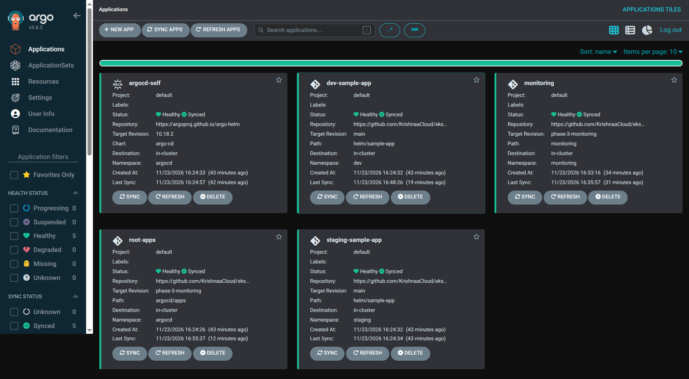
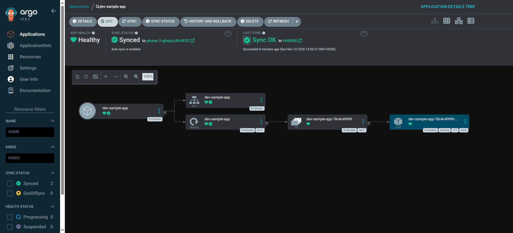
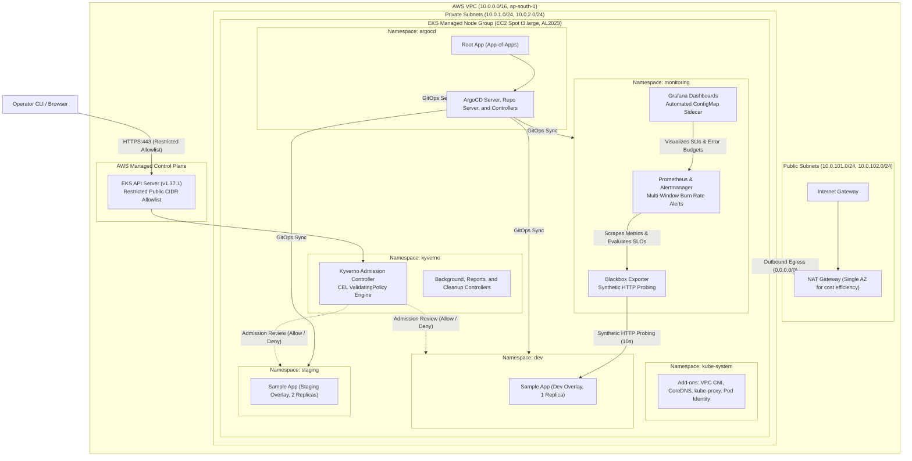

# EKS Platform

A production-style Kubernetes platform on AWS EKS, built with Terraform and managed with GitOps (ArgoCD), with policy guardrails (Kyverno). Rebuilt and destroyed on demand, so nothing runs between sessions.

## What This Is and Why

My primary production background is operating AWS ECS at scale across mission-critical services. This project applies that same platform thinking and operational discipline to Kubernetes. It is a reference platform I built to show how I would run Kubernetes, and every number here was measured.

## Screenshots


*ArgoCD showing all four applications (argocd-self, dev-sample-app, root-apps, and staging-sample-app) Synced and Healthy after the Phase 2 bootstrap.*


*Resource tree for dev-sample-app showing Healthy and Synced status across Service, Deployment, ReplicaSet, and Pod components.*

## Measured Results

All metrics below are verified from recorded execution outputs in the evidence directory:

| Metric | Measured Value | Verification Source |
| :--- | :--- | :--- |
| Terraform resources | [58](docs/evidence/apply.log) resources provisioned | [apply.log](docs/evidence/apply.log) |
| Cluster build (apply) | [11m 26s](docs/evidence/apply.log) (Phase 2), [11m 52s](docs/evidence/phase-3-verification.md#1-measured-cluster-timing) (Phase 3) | [apply.log](docs/evidence/apply.log) / [phase-3-verification.md](docs/evidence/phase-3-verification.md#1-measured-cluster-timing) |
| Cluster teardown (destroy) | [11m 33s](docs/evidence/phase-1-verification.md#timings) (Phase 1), [10m 30s](docs/evidence/destroy.log) (Phase 2) | [phase-1-verification.md](docs/evidence/phase-1-verification.md#timings) / [destroy.log](docs/evidence/destroy.log) |
| Kubernetes version and nodes | [1.37.1](docs/evidence/phase-1-verification.md#1-node-status-kubectl-get-nodes--o-wide), [2](docs/evidence/phase-1-verification.md#1-node-status-kubectl-get-nodes--o-wide) nodes Ready | [phase-1-verification.md](docs/evidence/phase-1-verification.md#1-node-status-kubectl-get-nodes--o-wide) |
| Pods running after bootstrap | [37](docs/evidence/phase-3-verification.md#deployed-workloads--system-pods) pods Running across 6 namespaces | [phase-3-verification.md](docs/evidence/phase-3-verification.md#deployed-workloads--system-pods) |
| ArgoCD applications | [5](docs/evidence/phase-3-verification.md#gitops-application-state-argocd) applications (all Synced and Healthy) | [phase-3-verification.md](docs/evidence/phase-3-verification.md#gitops-application-state-argocd) |
| Kyverno policies enforced | [3](docs/evidence/phase-2-verification.md#3-dedicated-denial-messages-by-policy) policies, each verified by admission denial | [phase-2-verification.md](docs/evidence/phase-2-verification.md#3-dedicated-denial-messages-by-policy) |
| Service Level Objectives (SLOs) | [2](docs/slo.md) SLOs (99% availability, 95% latency <50ms) with multi-window burn rate alerts | [slo.md](docs/slo.md) |

## Architecture



## Repository Layout

```text
.
├── .github/
│   └── workflows/              # CI workflows (planned Phase 5)
├── argocd/
│   ├── root-app.yaml           # Root application for GitOps app-of-apps bootstrap
│   └── apps/                   # Application definitions (self, dev, staging, monitoring)
│       ├── argocd-self.yaml
│       ├── dev-sample-app.yaml
│       ├── monitoring.yaml
│       └── staging-sample-app.yaml
├── docs/
│   ├── adr/                    # Architectural Decision Records (0001 to 0007)
│   │   ├── 0001-managed-node-groups.md
│   │   ├── 0002-single-nat-gateway.md
│   │   ├── 0003-spot-instances-for-worker-nodes.md
│   │   ├── 0004-restricted-public-api-endpoint.md
│   │   ├── 0005-kubernetes-version-selection.md
│   │   ├── 0006-ecs-vs-eks-and-local-state.md
│   │   └── 0007-blackbox-probing-for-slos.md
│   ├── evidence/               # Measured execution logs and verification evidence
│   │   ├── apply.log           # Timed apply log (Phase 2 & 3)
│   │   ├── destroy.log         # Timed destroy log (Phase 2)
│   │   ├── phase-1-verification.md
│   │   ├── phase-2-verification.md
│   │   └── phase-3-verification.md
│   ├── images/                 # Platform UI screenshots
│   │   ├── argocd-applications.png
│   │   └── argocd-dev-sample-app-tree.png
│   ├── cost.md                 # Architecture cost model
│   └── slo.md                  # SLO specifications, burn rate math, drill results
├── helm/
│   └── sample-app/             # Pinned NGINX microservice Helm chart
│       ├── Chart.yaml
│       ├── templates/
│       ├── values.yaml         # Base values (resource limits, health probes)
│       ├── values-dev.yaml     # Dev environment overlay
│       └── values-staging.yaml # Staging environment overlay
├── kyverno/
│   └── policies/               # CEL-based ValidatingPolicy resources
│       ├── disallow-latest-tag.yaml
│       ├── disallow-privileged-containers.yaml
│       └── require-resource-limits.yaml
├── monitoring/                 # Observability stack Helm chart & SLO manifests
│   ├── Chart.yaml
│   ├── values.yaml             # Small resource limits, 6h retention, emptyDir storage
│   ├── charts/                 # Pinned vendor tarballs (zero-EBS deployment)
│   └── templates/
│       ├── probe.yaml          # Prometheus Operator Probe targeting dev-sample-app
│       ├── slo-rules.yaml      # Recording rules & multi-window burn rate alerts
│       └── slo-dashboard.yaml  # ConfigMap sidecar with Grafana SLO dashboard
└── terraform/                  # Infrastructure as Code
    ├── main.tf                 # VPC and EKS module configurations
    ├── outputs.tf              # Cluster endpoints, ARN, OIDC issuer
    ├── variables.tf            # Region, CIDRs, node group sizing
    └── versions.tf             # Pinned providers and AWS account validation
```

## How to Run It

### Prerequisites
- AWS CLI v2 configured with appropriate IAM credentials
- Terraform >= 1.9
- kubectl >= 1.30
- Helm >= 3.16

### 1. Plan
Authorize your current workstation IP address for the EKS control plane API allowlist, initialize Terraform, and generate an execution plan:
```bash
export TF_VAR_my_ip_cidr="$(curl -s https://checkip.amazonaws.com)/32"
cd terraform
terraform init
terraform plan -out=tfplan
```

### 2. Timed Apply
Apply the plan and record the execution duration:
```bash
time terraform apply tfplan 2>&1 | tee ../docs/evidence/apply.log
```

### 3. Bootstrap GitOps and Policy Engine
Update your local kubeconfig and bootstrap Kyverno and ArgoCD:
```bash
aws eks update-kubeconfig --region ap-south-1 --name eks-platform

# Install Kyverno admission controller and apply CEL policies
helm repo add kyverno https://kyverno.github.io/kyverno
helm repo update
helm upgrade --install kyverno kyverno/kyverno \
  --namespace kyverno \
  --create-namespace \
  --version 3.10.0 \
  --wait
kubectl apply -f ../kyverno/policies/

# Install ArgoCD and apply root app-of-apps
helm repo add argo https://argoproj.github.io/argo-helm
helm repo update
helm upgrade --install argocd argo/argo-cd \
  --namespace argocd \
  --create-namespace \
  --version 10.18.2 \
  --wait
kubectl apply -f ../argocd/root-app.yaml
```

### 4. Timed Teardown
Decommission all AWS resources and record the teardown duration:
```bash
time terraform destroy -auto-approve 2>&1 | tee ../docs/evidence/destroy.log
```

## Production Gaps

This platform is deliberately scoped as an engineering portfolio reference rather than an active production deployment. The following gaps are recognized:
- Local Terraform state: State resides on the local filesystem without a remote S3 backend or DynamoDB state locking.
- Single operator: Access and infrastructure changes are executed by a single operator without multi-user role separation.
- Manual GitOps and policy bootstrap: GitOps and policy bootstrap is manual helm and kubectl, not automated in Terraform.
- Policy management outside GitOps: Kyverno policies are not yet managed by ArgoCD.
- No CI plan or apply pipeline: Infrastructure execution is performed directly from the CLI rather than through automated pipeline checks and pull request automation.
- No persistent metrics storage: Prometheus, Alertmanager, and Grafana run with emptyDir ephemeral volumes to maintain zero EBS storage cost during on-demand sessions. Historical metrics do not persist across cluster rebuilds.
- No multi-region redundancy: Networking and compute are deployed exclusively in AWS region ap-south-1.
- No service mesh: Workloads rely on core Kubernetes ClusterIP networking without mutual TLS or fine-grained traffic routing.
- Single-account setup: Control plane, compute, and networking reside within a single AWS account rather than separated across multi-account landing zones.
- Ephemeral cost control: Costs are managed by rebuilding on demand and destroying after each session rather than maintaining continuous uptime.

## Roadmap

- Phase 3: Observability, Monitoring, and SLOs (Completed)
  - Deployed kube-prometheus-stack (Prometheus, Alertmanager, Grafana) and prometheus-blackbox-exporter via ArgoCD.
  - Pinned small resource limits and emptyDir ephemeral volumes for zero EBS storage costs.
  - Defined explicit availability (99.0%) and latency (95.0% <50ms) SLOs with Prometheus recording rules.
  - Implemented multi-window multi-burn-rate alerts (critical fast burn and warning slow burn).
  - Deployed automated Grafana dashboard and validated alerting with an empirical failure drill.
- Phase 4: Failure Drills and Resilience Testing
  - Conduct node drain and termination drills to evaluate Pod Disruption Budgets and pod rescheduling behavior.
  - Execute admission controller failure tests to assess cluster behavior during webhook unavailability.
  - Measure platform recovery time from complete cold start.
- Phase 5: CI/CD Automation with OIDC and Remote State
  - Migrate Terraform state to Amazon S3 with DynamoDB state locking.
  - Establish GitHub Actions CI pipelines using AWS IAM OIDC federation (eliminating static credentials).
  - Automate validation, linting, policy conformance checks, and plan generation on pull requests.

## Architectural Decision Records (ADRs)

- [ADR 0001: Managed Node Groups](docs/adr/0001-managed-node-groups.md)
- [ADR 0002: Single NAT Gateway](docs/adr/0002-single-nat-gateway.md)
- [ADR 0003: Spot Instances for Worker Nodes](docs/adr/0003-spot-instances-for-worker-nodes.md)
- [ADR 0004: Restricted Public API Endpoint](docs/adr/0004-restricted-public-api-endpoint.md)
- [ADR 0005: Kubernetes Version Selection](docs/adr/0005-kubernetes-version-selection.md)
- [ADR 0006: ECS vs EKS and Local State](docs/adr/0006-ecs-vs-eks-and-local-state.md)
- [ADR 0007: Synthetic Blackbox Probing for SLOs](docs/adr/0007-blackbox-probing-for-slos.md)
